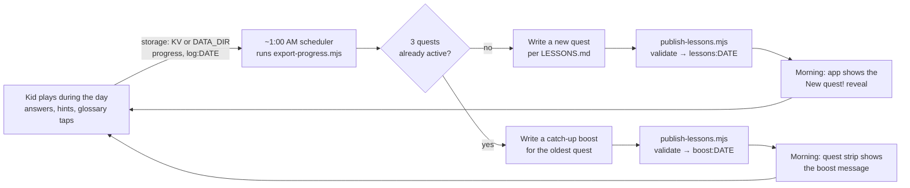

# How the nightly cycle works

Every night, a lesson author reads the day's results and writes tomorrow's quest. In Kent's household that author is
**Grok Bot**, an AI assistant, running as a scheduled routine. **The app doesn't depend on Grok Bot or any outside
service.** The interface is two scripts, [`export-progress.mjs`](../export-progress.mjs) and
[`publish-lessons.mjs`](../publish-lessons.mjs), plus the rules in [LESSONS.md](../LESSONS.md). Anyone can run the cycle
on whatever scheduler they like, and write the pack by hand or with any assistant.



> **Offline authoring, never live AI.** The nightly author (a person, Grok Bot or any assistant) works *ahead of
> time*. What it writes is validated by `publish-lessons.mjs` before the app can show it, and the app itself never calls
> a model while the kid plays. See [README → Philosophy](../README.md#philosophy).

## 1. Schedule (about 1:00 AM local time)
The routine runs once a night, around **1:00 AM local time**, after the kid's day is over and before the next one starts.
Dates are Pacific Time days (`ptDate` in the code). In this deployment a scheduled Grok Bot routine runs it. For your
own install, use any scheduler (see [Run it yourself](#run-it-yourself)).

## 2. Export the day (read-only)
```bash
node export-progress.mjs          # → exports/progress-<PT date>.json (gitignored: it contains the child's data)
```
The export includes:
- **`learner`**: name, target age and grade from `wrangler.toml` `[vars]` (or the `LEARNER_*` env vars with `--local`).
- **`todayLog`**: every answer of the day, plus mastered, inferred and demoted events.
- **`weakSpots`** (last 7 days, `--days N`): first-try misses, hints, slow answers, failed reviews and "not sure"
  self-checks per topic and domain. Also `goDeeper` (with easier prerequisite steps) and `strengths` (with `stretchTo`
  topics).
- **`termsLookedUp`**: glossary words the kid tapped.
- **`quests`**: active quests, the cap (3) and `nextStep` (a new quest, or a catch-up boost).
- **`frontier`**: ready and learning topics, closest to the target age first.
- **`reviewDue`**: mastered topics whose spaced review is due.
- **`summary`**, **`stats`** and the raw **`progress`** record.

## 3. Check the quest cap
At most **3 quests** can be active (started and unfinished) at a time. The routine reads `quests.nextStep`:
- **Under the cap:** write a **new quest** for tomorrow.
- **At the cap:** write a **catch-up boost** for the **oldest** active quest instead
  (`{"boostFor":"<quest date>", ...}`). It trims stages that have a lot left, adds hints and shows an encouraging
  message. `publish-lessons.mjs` also refuses to publish a new quest at the cap unless you pass `--force`.

## 4. Write the pack (rules in LESSONS.md)
- **Teach → guided practice → graded → boss, always.** Every new or shaky skill starts with a `learn` card (idea + one
  worked example), then 1-2 `guided` questions with `steps`, then graded ones. The boss only tests skills taught or
  practised earlier in the quest (`teaches`) or already mastered, and gets a `powerup` recap. The publisher fails a
  pack that breaks this, or a boss answer past thousandths (see LESSONS.md "Teach → guided practice → graded → boss").
- **Gentle on stuck topics.** `weakSpots.needsSupport` (the kid tapped "I'm stuck" or skipped) → a gentle deep dive that
  starts a full level down (e.g. sixteenths via eighths, halving or money), no boss on that skill tomorrow, and
  `example`/`steps` on its questions. `weakSpots.requeued` lists skipped items the app brings back by itself, guided.
- **Go deeper on struggles.** For every `goDeeper` topic, add a deep dive: a `learn` card and guided items first, then 4-5 graded
  questions that start one notch easier and climb back up, in at least 3 formats.
- **Stretch strengths.** Add a new topic next to the strongest domains (`stretchTo`).
- **Never below level.** Nothing starting more than 2 years below the target age, and no baby wording.
- **About 15-20% spaced review.** Mark stages `"review": true`. Prefer `reviewDue` topics.
- **Size.** About 28 graded questions over about 8-9 stops, ending with a boss stage. The publisher warns above 30
  graded questions or 9 stops.
- **Kid voice.** Talk to the kid as "you", 15 words or fewer, fun, and write `{name}` instead of a real name.
- **Creative answers.** Open questions use `creative` (any sensible answer is celebrated) or broad `acceptedAnswers`.
- **Terms.** Define new words in the pack's `terms`, and reuse words the kid looked up.
- Start from [`packs/examples/example-quest.json`](../packs/examples/example-quest.json). Real packs
  (`packs/*.json`) are gitignored because they are written from a real child's answers.

## 5. Validate and publish
```bash
node publish-lessons.mjs packs/2026-10-18.json --dry-run   # validate only; fix every error and warning
node publish-lessons.mjs packs/2026-10-18.json             # → KV lessons:2026-10-18
node publish-lessons.mjs boost.json                        # at the cap → KV boost:<quest date>
# Node server / Docker: add --local (or set STORAGE=file) to every command; it reads and writes DATA_DIR instead of KV.
```
Nothing is written if the pack is invalid (the script exits 1 and lists every problem).

## 6. In the morning
When the kid opens the app and today's quest hasn't been started (and fewer than 3 are active), Jane plays the animated
**"New quest!"** reveal, and the Quests tab shows a red dot. If a boost was published instead, the quest strip shows its
message and the trimmed or hinted stages apply right away. Preview either one in the sandbox first:
`/api/sandbox?on=1`, then `POST /api/sandbox/reset {"offsetDays":1}`.

## Spaced review: how it's scheduled and mixed in
- **Leitner boxes:** 1 → 3 → 7 → 21 → 60 days. A topic the kid masters directly is due after **1 day**. Each review
  answered right on the first try moves it up one box (up to 60 days). A missed review brings it back the next day,
  or sends it back to "learning".
- **Inferred topics** (credited because the kid showed a harder skill that builds on them) start in a later box and
  come due after roughly **10-40 days**, spread out so they don't all arrive at once.
- **In normal play** the engine slips one due review into the session every so often: after the first few items, about
  every 9 items or by chance. It prefers topics the kid showed directly.
- **In a quest** the quest's own `review` stages take the place of the engine's reviews. A first-try correct answer on a
  due review stage moves the topic up a box, and a miss brings it back tomorrow. The nightly author picks these from
  `reviewDue`, which is how the ~15-20% review share is kept.

## When the routine messages the parent
Usually never. It stays quiet on a normal night. It only reaches out when something **fails** (the export or publish
errors, or a pack it can't make valid) or **matters**, for example the quest cap being hit night after night, a new
struggle spot that keeps coming back, or a big milestone. The parent report (`/parent`) is the everyday view.

## Run it yourself
You don't need Grok Bot or any other service. The scripts are the whole interface:
1. **Export:** `node export-progress.mjs` (on Cloudflare: needs `CLOUDFLARE_API_TOKEN` and your `wrangler.toml`; on the
   Node server or Docker: add `--local`, see [INSTALL.md](../INSTALL.md)).
2. **Author:** write `packs/<tomorrow>.json` by hand, or give the export and [LESSONS.md](../LESSONS.md) to any assistant
   you like and ask it for a pack.
3. **Publish:** `node publish-lessons.mjs packs/<tomorrow>.json --dry-run`, then without `--dry-run`.

Any scheduler works for the export, and for the publish step too if packs are generated automatically. For example cron:
```cron
# 1:00 AM local time: export for the morning's author (or your own script that exports, authors and publishes)
0 1 * * *  cd /path/to/jane && node export-progress.mjs >> exports/nightly.log 2>&1
```
You can also use launchd, Windows Task Scheduler, a CI schedule, or just a reminder to do it by hand each evening.
If a night is skipped, the app keeps working: it falls back to its built-in diagnostics, generators, kid questions and
spaced reviews.

**With an assistant.** Any assistant can be the author: give it the export and LESSONS.md and ask for a pack. An
assistant that has its own computer (like Grok Bot) can run the whole cycle there on its own schedule: export, write,
validate, publish, and message you only when something needs attention. For a suggested setup prompt, see
[README → Adapt it to your setup](../README.md#adapt-it-to-your-setup).

**Cloudflare Cron Trigger.** The natural built-in home for this is a
[Cron Trigger](https://developers.cloudflare.com/workers/configuration/cron-triggers/) on the same Worker
(`[triggers] crons = ["0 8 * * *"]` ≈ 1:00 AM PT during daylight time; cron times are in UTC). Today the Worker has no
`scheduled()` handler. Authoring happens outside it through the two scripts, so a Cron Trigger only becomes useful
together with the planned generator below.

## Planned: a built-in nightly generator
Not built yet. The plan is a `scheduled()` handler in the Worker, run by a Cron Trigger. It would build a rules-based
quest (or a catch-up boost) from the same data the export produces, using the kid prompts, generators and LESSONS.md
rules, then validate it and write `lessons:YYYY-MM-DD` itself. That would make the nightly cycle work with zero setup.
Hand-written or assistant-written packs would still take priority when one is published.

If the generator ever uses an LLM, it would follow the same philosophy: it would **author packs offline, at night**, and
each pack would go through the same validation before publishing. It would **never chat live** with the kid or generate
anything during play.
